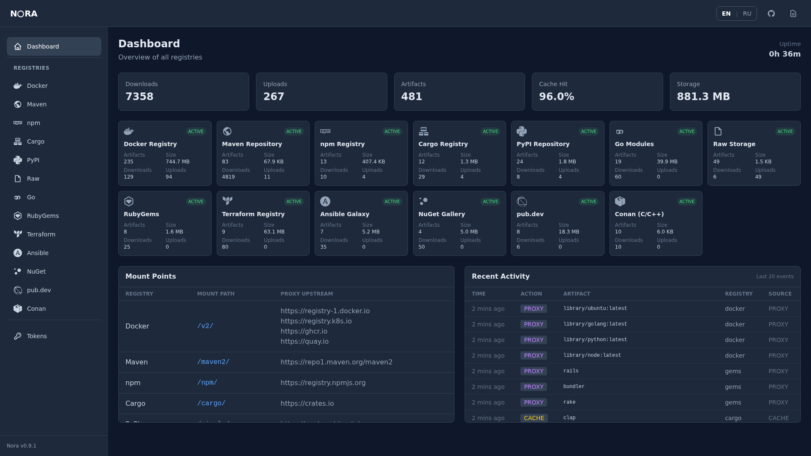

# NORA

**The artifact registry that grows with you.** Starts with `docker run`, scales with your needs.

```bash
docker run -d -p 4000:4000 -v nora-data:/data getnora/nora:latest
```

Open [http://localhost:4000/ui/](http://localhost:4000/ui/) — your registry is ready.

<p align="center">
  
</p>

## Why NORA

- **Zero-config** — single binary, no database, no dependencies. `docker run` and it works.
- **16 registries** — Docker, Maven, npm, PyPI, Cargo, Go, Raw, RubyGems, Terraform, Ansible Galaxy, NuGet, Pub (Dart/Flutter), Conan (C/C++), CPAN, RPM (yum/dnf), Debian/APT.
- **Secure by default** — [OpenSSF Scorecard](https://scorecard.dev/viewer/?uri=github.com/getnora-io/nora), signed releases, SBOM, fuzz testing, 2000+ tests.

[](https://github.com/getnora-io/nora/releases)
[](LICENSE)
[](https://artifacthub.io/packages/helm/nora/nora)
[](https://hub.docker.com/r/getnora/nora)

**< 35 MB** binary | **< 50 MB** RAM idle | **3s** startup | **16** registries

## Supported Registries

Authentication is off by default: every endpoint is public until you set `NORA_AUTH_ENABLED=true` (see [Configuration](#configuration)). With it on, anonymous read is opt-in via `NORA_AUTH_ANONYMOUS_READ=true`.

| Format | Pull (proxy/cache) | Push/Publish | Default Upstream | Notes |
|--------|:---:|:---:|---|---|
| Docker Registry v2 | ✅ | ✅ | `registry-1.docker.io` | hosted + proxy; cache on when `docker.upstreams` non-empty (Docker Hub by default) |
| Maven | ✅ | ✅ | `repo1.maven.org/maven2` | hosted + proxy |
| npm | ✅ | ✅ | `registry.npmjs.org` | hosted + proxy |
| Cargo | ✅ | ✅ | `crates.io` (sparse index) | hosted + proxy (sparse index) |
| PyPI | ✅ | ✅ | `pypi.org/simple/` | hosted + proxy |
| Go Modules | ✅ | — | `proxy.golang.org` | proxy only (modules immutable, push not in protocol) |
| Raw files | ❌ | ✅ | — (no upstream) | hosted only; conditional `PUT`/`GET` (ETag, `If-Match`, `If-None-Match`) on every backend; upload verification via `Repr-Digest` (RFC 9530) |
| RubyGems | ✅ | ❌ | `rubygems.org` | proxy only — `gem push` not implemented |
| Terraform | ✅ | — | `registry.terraform.io` | proxy only; client configuration notes in COMPAT.md |
| Ansible Galaxy | ✅ | ❌ | `galaxy.ansible.com` | proxy only — `ansible-galaxy collection publish` not implemented |
| NuGet | ✅ | ❌ | `api.nuget.org` | proxy only — `dotnet nuget push` not implemented |
| Pub (Dart/Flutter) | ✅ | ❌ | `pub.dev` | proxy only — `dart pub publish` not implemented |
| CPAN | ✅ | — | `www.cpan.org` | proxy only |
| Conan (C/C++) | ✅ | ❌ | `center2.conan.io` | proxy only (Conan 2 clients) |
| RPM (yum/dnf) | ⚠️ | ✅ | — (none by default) | hosted; pull-through via `[rpm.proxies]` / `NORA_RPM_PROXIES` (off by default); auto-generates `repodata/` |
| Debian/APT | ⚠️ | ✅ | — (none by default) | hosted; pull-through via `[deb.proxies]` / `NORA_DEB_PROXIES` (off by default); flat & structured layouts; auto-generates `Packages`/`Release`/`InRelease` |

> **Helm charts** work via the Docker/OCI endpoint — `helm push`/`pull` with `--plain-http` or behind TLS reverse proxy.

> **Pull/Push legend:** ✅ supported · ⚠️ pull-through available but off by default (no default upstream) · ❌ not implemented · — not applicable (protocol has no push). Per-format details and cache strategy in [COMPAT.md](COMPAT.md).

## Quick Start

### Docker (Recommended)

```bash
docker run -d -p 4000:4000 -v nora-data:/data getnora/nora:latest
```

### Binary

```bash
# x86_64
curl -fsSL https://github.com/getnora-io/nora/releases/latest/download/nora-linux-amd64 -o nora

# ARM64 (Raspberry Pi, Graviton, Apple Silicon VMs)
curl -fsSL https://github.com/getnora-io/nora/releases/latest/download/nora-linux-arm64 -o nora

chmod +x nora && ./nora
```

### Debian / RPM package

Each release also ships `.deb` and `.rpm` packages (amd64, arm64) with a systemd unit:

```bash
# Debian / Ubuntu
curl -fsSLO https://github.com/getnora-io/nora/releases/latest/download/nora-amd64.deb
sudo apt install ./nora-amd64.deb

# RHEL / Fedora
sudo dnf install https://github.com/getnora-io/nora/releases/latest/download/nora-amd64.rpm
```

Settings live in `/etc/nora/nora.env`, data in `/var/lib/nora`.

`./nora` listens on `127.0.0.1:4000`. To expose it on a network, set the bind
address and the public URL clients should use for download links:

```bash
NORA_HOST=0.0.0.0 NORA_PUBLIC_URL=https://registry.example.com ./nora
```

### Kubernetes (Helm)

```bash
helm repo add nora https://getnora-io.github.io/helm-charts
helm install nora nora/nora
```

### From Source

```bash
cargo install nora-registry --locked
nora
```

## Usage

```bash
# Docker
docker tag myapp:latest localhost:4000/myapp:latest
docker push localhost:4000/myapp:latest

# npm (npm publishes only with a token for the registry: any value while auth
# is off, an API token when it is on)
npm config set registry http://localhost:4000/npm/
npm config set //localhost:4000/npm/:_authToken=<token>
npm publish

# Go (inside a module; `go mod download module@version` works anywhere)
GOPROXY=http://localhost:4000/go go get golang.org/x/text@latest

# CPAN
cpanm --from http://localhost:4000/cpan Module::Name
```

See [full documentation](https://getnora.dev) for all registries.

## Features

- **Web UI** — dashboard with search, browse, i18n (EN/RU/ZH)
- **Proxy & Cache** — transparent proxy to upstream registries with local cache
- **Curation** — blocklist, allowlist, namespace isolation, integrity verification, min-release-age filter, digest quarantine
- **Token RBAC** — read/write/admin roles, expiry tracking, deferred last_used flush
- **OIDC workload identity** — keyless CI publishing from GitHub Actions and GitLab CI (Bearer clients such as npm)
- **Mirror CLI** — offline sync for air-gapped environments (`nora mirror`)
- **Backup & Restore** — `nora backup` / `nora restore`
- **Import** — one-shot migration from Artifactory and Nexus (`nora import`)
- **Object Storage** — AWS S3, Ceph RGW, any S3-compatible backend, Google Cloud Storage
- **Prometheus Metrics** — `/metrics` endpoint, [Grafana dashboard](MONITORING.md)
- **Rate Limiting** — configurable per-endpoint rate limits

## Configuration

NORA works out of the box. For advanced setup — auth, S3, retention, curation — see [getnora.dev/configuration](https://getnora.dev/configuration/settings/).

```bash
# Auth
docker run -d -p 4000:4000 \
  -v nora-data:/data \
  -v ./users.htpasswd:/data/users.htpasswd \
  -e NORA_AUTH_ENABLED=true \
  -e NORA_AUTH_HTPASSWD_FILE=/data/users.htpasswd \
  getnora/nora:latest
```

```bash
# Curation — hold upstream packages for 7 days after NORA first sees them
docker run -d -p 4000:4000 \
  -v nora-data:/data \
  -e NORA_CURATION_MODE=enforce \
  -e NORA_CURATION_MIN_RELEASE_AGE=7d \
  -e NORA_CURATION_QUARANTINE=enforce \
  -e NORA_CURATION_QUARANTINE_TTL=7d \
  getnora/nora:latest
```

On a proxy registry `min_release_age` needs the quarantine: upstream publish dates
are unsigned, so NORA refuses to start with a min-age-only policy.

### Retention

Retention rules can limit eligible version names with `include_tags`. Empty or
omitted patterns preserve the existing behavior of considering all names;
`exclude_tags` still protects matching names. Only eligible, non-excluded names
consume the `keep_last` budget. For example, this rule keeps the newest ten
preview tags in each matching repository and only retires older previews after
14 days, measured from object modification rather than last access:

```toml
[[retention.rules]]
registry = "docker"
name_glob = "myapp*"
include_tags = ["preview-*"]
exclude_tags = ["preview-protected"]
keep_last = 10
older_than_days = 14
```

## Performance

| Metric | NORA | Nexus | JFrog |
|--------|------|-------|-------|
| Startup | < 3s | 30-60s | 30-60s |
| Memory | < 50 MB idle | 2-4 GB | 2-4 GB |
| Binary | < 35 MB | 600+ MB | 1+ GB |

## Roadmap

- ~~Mirror CLI~~ ✅ v0.4.0
- ~~Garbage Collection & Retention~~ ✅ v0.6.0
- ~~Helm Chart~~ ✅ v0.6.1
- ~~Signed releases & SBOM~~ ✅ v0.6.4
- ~~Curation layer & 13 registry formats~~ ✅ v0.7.0
- ~~Min Release Age~~ ✅ v0.7.1
- ~~Hash Pin Store, auth rate limiting, Cache-Control~~ ✅ v0.8.0
- ~~Outbound proxy, structured audit log~~ ✅ v0.8.3
- ~~Circuit breaker, OIDC, hot reload, arm64, streaming uploads~~ ✅ v0.9.0
- ~~NuGet V3 stabilization, Cargo ETag, 1049 tests~~ ✅ v0.9.1
- ~~Prometheus metrics, Ansible Galaxy v3, security fixes, 1086 tests~~ ✅ v0.9.2
- ~~Security hardening, null byte protection, config refactor, 1204 tests~~ ✅ v0.9.3
- ~~Multi-upstream PyPI, conditional-request revalidation, single-flight coalescing, per-registry metrics~~ ✅ v0.9.4
- ~~Digest quarantine across all registries, trusted upstream dates, token access-control hardening~~ ✅ v0.9.5
- ~~RPM and Debian/APT registries, signed repository indexes, `nora import` from Artifactory and Nexus~~ ✅ v1.0.0
- ~~Google Cloud Storage backend, structured APT layout, rpm/deb reindex~~ ✅ v1.0.1
- ~~rpm/deb pull-through proxy and offline mirror, per-rule OIDC namespace scope~~ ✅ v1.1.0
- ~~Resumable downloads for every format, Docker cross-repo blob mount~~ ✅ v1.2.0
- ~~CPAN proxy~~ ✅ v1.3.2
- ~~npm upstreams by scope, per-upstream circuit breakers, unknown config keys reported~~ ✅ v1.3.4
- ~~Curation and internal namespaces judge every name and version the way its format resolves it~~ ✅ v1.3.5
- **Image Signing Policy** — cosign verification on upstream pulls
- **Semver contract** — stable API, configuration format, and storage layout

See [ROADMAP.md](ROADMAP.md) for the full roadmap and [CHANGELOG.md](CHANGELOG.md) for release history.

## Security & Trust

[](https://scorecard.dev/viewer/?uri=github.com/getnora-io/nora)
[](https://www.bestpractices.dev/projects/12207)
[](https://github.com/getnora-io/nora/actions/workflows/ci.yml)
[](https://github.com/getnora-io/nora/actions)

See [SECURITY.md](SECURITY.md) for vulnerability reporting.

## Documentation

Full documentation: **https://getnora.dev**

## Companion

[**Dozor**](https://github.com/getnora-io/dozor) writes NORA's curation
blocklist. It compiles the OSV advisory feed together with an inventory of what
your registry actually holds into a `blocklist.json`, and NORA enforces it — no
NORA configuration beyond `curation.blocklist_path`, and no changes to NORA
itself. Separate binary, separate repository, MIT.

## Author

Created and maintained by [Pavel Volkov](https://github.com/devitway)

[](https://getnora.dev)
[](https://t.me/getnora)
[](https://github.com/getnora-io/nora)

## Contributing

NORA welcomes contributions! See [CONTRIBUTING.md](CONTRIBUTING.md) for guidelines.

## License

MIT License — see [LICENSE](LICENSE)

Copyright (c) 2026 The NORA Authors
